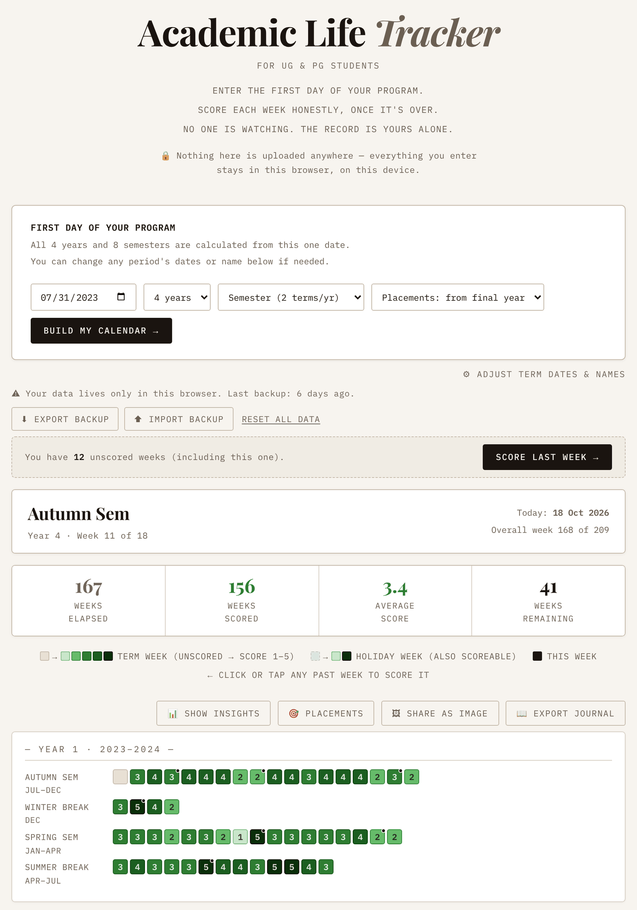
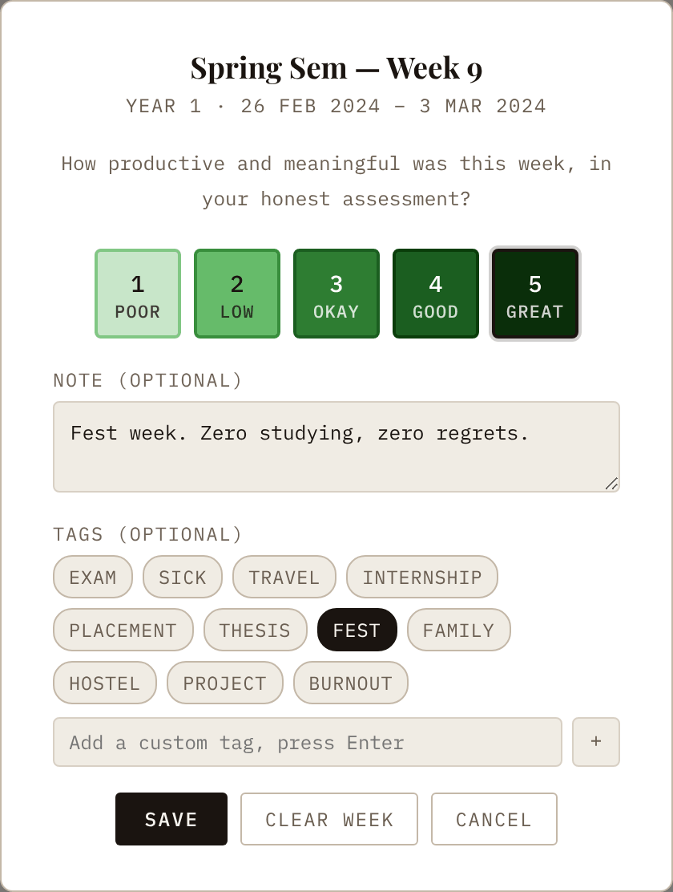
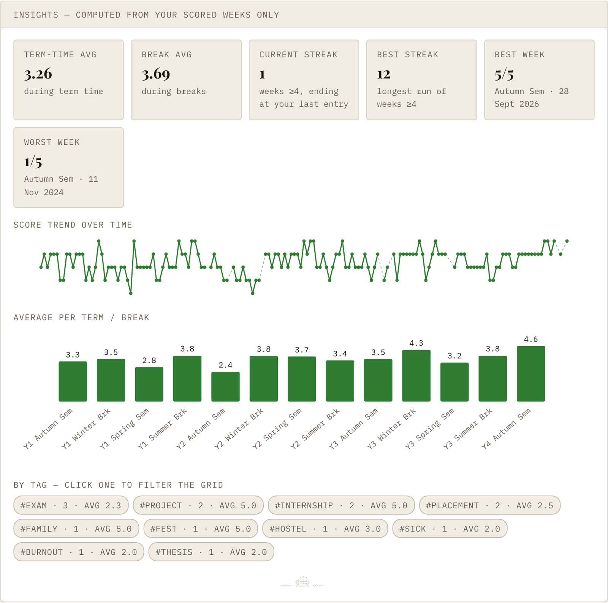
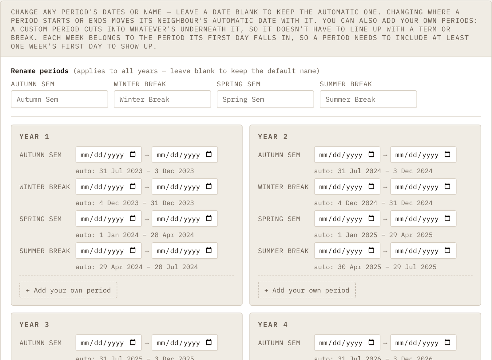
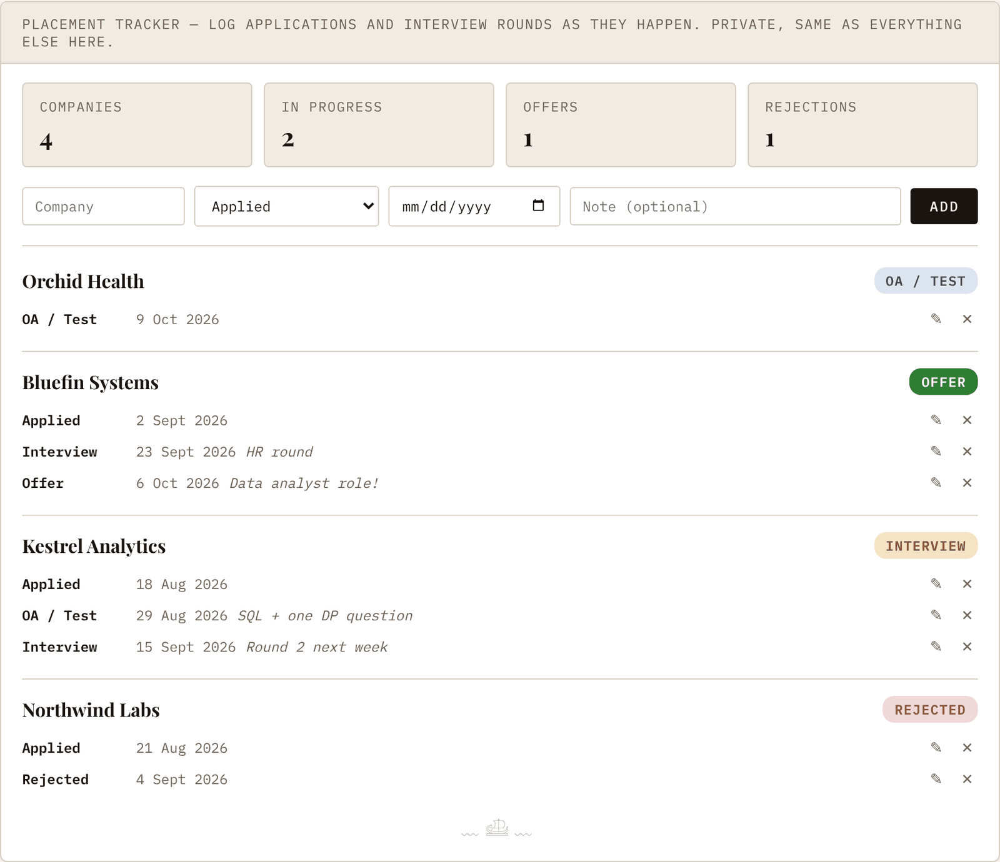
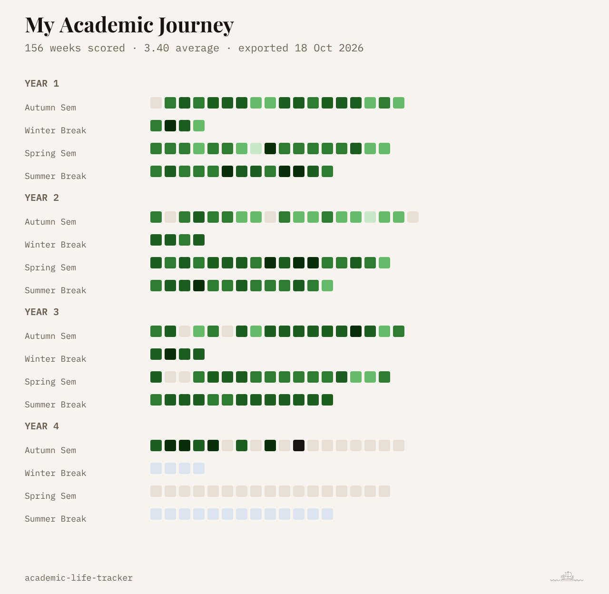
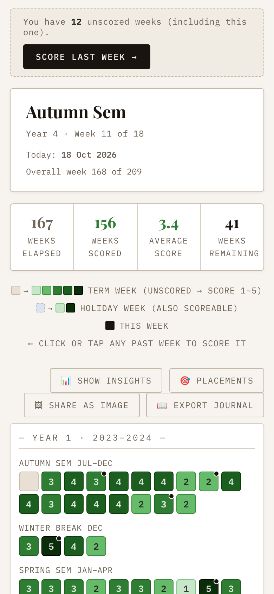
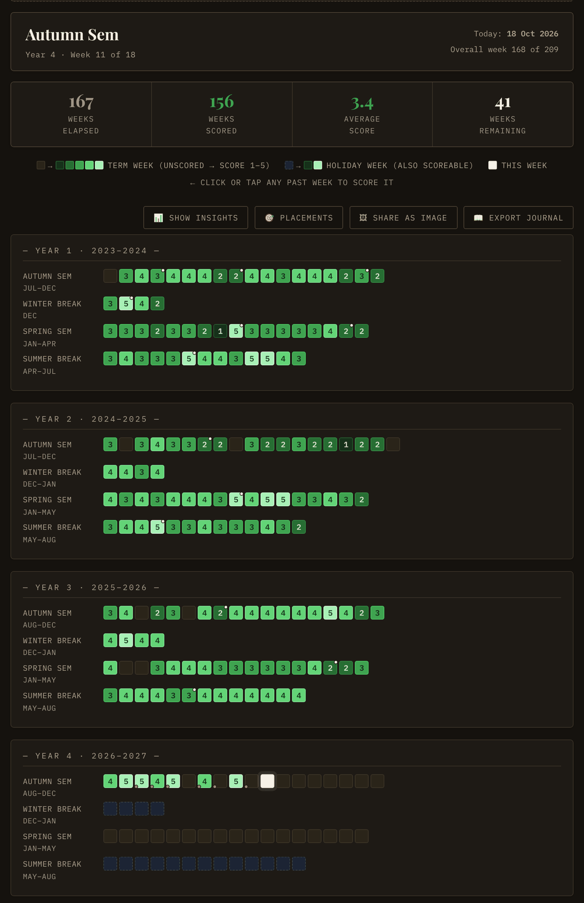

# Academic Life Tracker

A week-by-week tracker for your degree, made for UG and PG students.

You enter the day your program started and how long it runs, and it draws every week as a small square, a bit like the contribution graph on GitHub. Once a week is over, you score it from 1 to 5 and the square gets shaded to match. You can add a note or a few tags too, so future you remembers why a week was good or terrible.

I started it as a small UG tracker and it kept growing. It now handles semesters, trimesters and yearly programs, and it has a corner for placement season.

  

## What you can do

- Build the whole calendar from one start date (2 to 6 years, semester, trimester or annual layout)
- Change the dates or names of any term or break, or add your own periods, like a study abroad term or an internship
- Score each week and attach a note and tags
- Catch up quickly with the **Score last week** button when you've missed a few
- Open the insights panel for streaks, term time vs break averages, your best and worst weeks, and how each tag scores on average
- Log placement applications: company, round, date, and how it went
- Export a backup file, a picture of your grid, or a journal in Markdown
- Install it on your phone or laptop like an app, and use it offline
- Switch between light and dark mode

## A closer look

### Scoring a week

Click any week that's over, or this one, and a small window opens. Pick a score, write a line about what happened if you want, and tag it. There are a few tags ready to go (exam, sick, fest, internship and so on) and you can add your own.

  

Weeks with a note get a small dot. If you've fallen behind, a banner shows up with a button that takes you to the most recent week you missed, so you don't have to hunt for it. If you clear a week by mistake, there's an Undo for a few seconds.

Try to score honestly. Nobody else sees this.

### Insights

Once you've scored a few weeks, **Show insights** gives you averages for term time and breaks, your current and best streak of good weeks, your best and worst weeks along with what you wrote about them, a trend line, an average for every term and break, and an average score for each tag. Click a tag and the grid shows only those weeks, which is how you find out whether exam weeks really are as bad as you remember.

  

### Fitting it to your college

Every college does dates a little differently. Under **Adjust term dates & names** you can move any term or break for any year, rename them (say "Odd Sem" instead of "Autumn Sem"), or add your own periods. Leave a date blank and it stays automatic, and it shows you what the automatic date is. If you move where one period ends, the next one moves with it.

  

It also stops you before saving dates that can't be right, like a typo that makes a semester run for 900 years, or a period you added under the wrong year.

### Placement season

From your final year, a **Placements** button shows up. You log each company and each round as it happens, and each company shows where things stand based on its latest round. You can edit or delete entries. A small gold dot on the grid marks the weeks something happened, so later you can see what else was going on that week.

  

If you want it from day one, or not at all, there's a setting for that next to the start date. Hiding it doesn't delete anything.

### Keeping your record

**Export backup** saves everything in one file, and **Import backup** brings it back. **Share as image** turns your whole grid into a picture. On a phone it opens the share menu straight away, on a laptop it downloads. **Export journal** writes all your scores and notes into a Markdown file you can read years from now.

  

### On your phone, and at night

It works fine on a phone. The squares get bigger so they're easy to tap. Dark mode follows your phone or laptop until you pick one yourself with the button in the corner.

  
  &nbsp;&nbsp;
  

There's also a small signature of mine hidden in there somewhere. If you spot a tiny boat, give it a click.

## About your data

Everything stays in your browser. There's no account and no server, so nothing you type gets sent anywhere. The only thing it loads from the internet is the fonts, from Google Fonts.

The catch is that your data lives in that one browser on that one device. If you clear your browser data it's gone, and what you fill in on your laptop won't appear on your phone. So hit **Export backup** every now and then, and use **Import backup** to restore it or move it somewhere else. The app tells you how long it's been since your last backup, and it turns red after a month.

## Files

- `index.html` is the app itself, the page and everything you click on
- `calendar.js` works out your terms, breaks and weeks from the start date and your settings
- `data.js` checks saved data and backup files before the app uses them, so a broken file can't break the app
- `sw.js` is the service worker, which lets it work offline after the first load
- `manifest.json` and the two icons let you install it on your phone or desktop like an app
- `tests/` has the tests for `calendar.js` and `data.js`
- `screenshots/` has the pictures in this README
- `.nojekyll`, `.gitattributes` and `.github/` are small files that help GitHub publish and test the project

Keep them in the same folder, since they find each other with relative paths. You can also just open `index.html` on your computer without putting it online.

## Putting it online

It's all static files, so GitHub Pages is enough.

1. Put all the files above in the root of a repo. The ones starting with a dot are hidden by default on Mac and Windows, so if you upload through the GitHub website, show hidden files first (on a Mac, press Cmd + Shift + . in Finder). `git` and GitHub Desktop pick them up on their own.
2. Go to Settings, then Pages, set the source to "Deploy from a branch", pick `main` and `/ (root)`, and save.
3. After a minute or so it's live at `https://yourusername.github.io/your-repo/`.

There's no build step and nothing to install.

When you change something later, also change `VERSION` at the top of `sw.js` (for example from `'V10'` to `'V11'`), so copies people have installed pick up the new files.

## Tests

If you have [Node.js](https://nodejs.org) 18 or newer, run `node --test` in the project folder. GitHub also runs them every time you push, and shows a ✓ or ✗ next to each commit under the Actions tab.

## License

MIT. Use it, change it, share it, even sell it if you want to. All I ask is that you keep my name and the license notice with it. The full text is in `LICENSE`.

## Contact

I'm Arush Giri. 
If you find a bug, have a suggestion or have an idea, email me at [rush.outward120@passinbox.com](mailto:rush.outward120@passinbox.com).

﹏𓊝﹏
